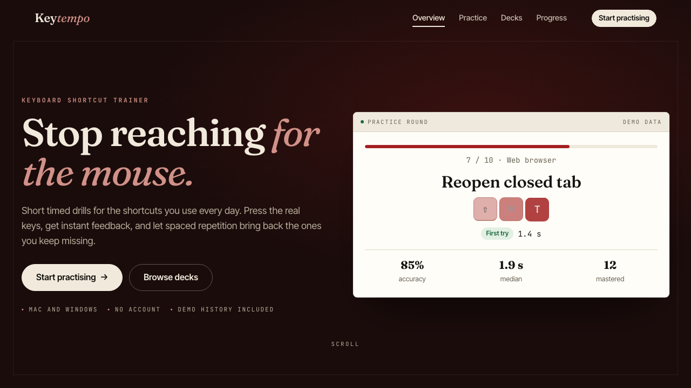
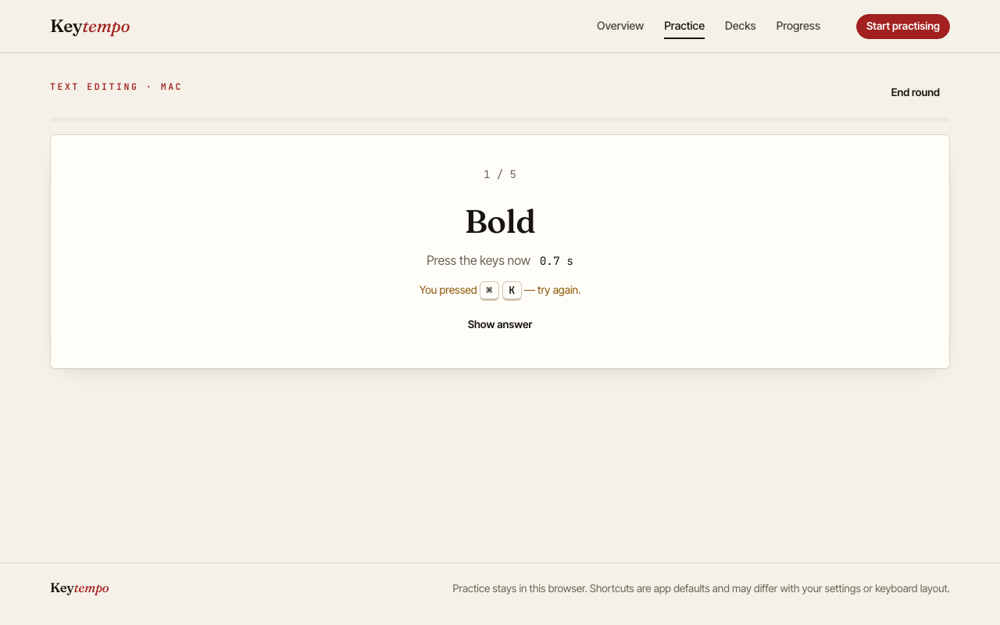
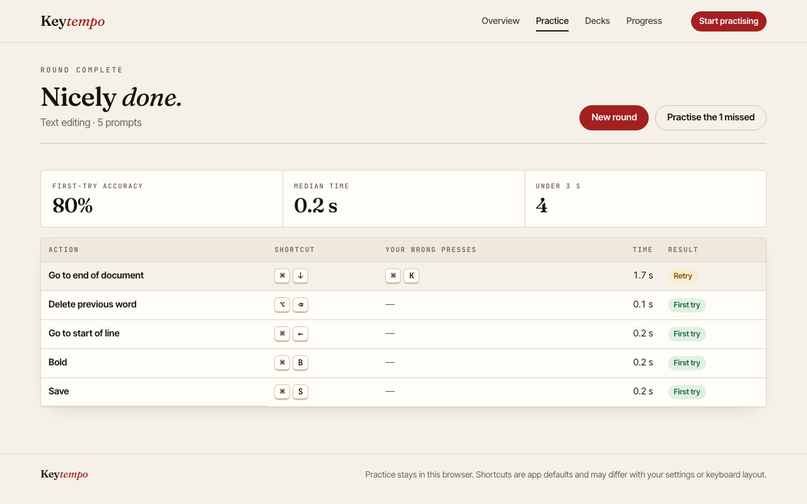
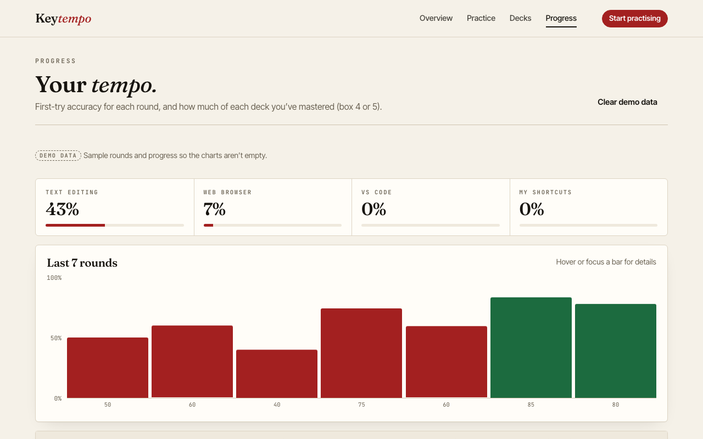

# Keytempo

A keyboard-shortcut trainer. Short timed rounds ask for an action, you press the real keys, and spaced repetition brings back the shortcuts you miss. Tracks first-try accuracy, median time and mastery per deck.

**Live demo:** [https://keytempo-app.vercel.app/](https://keytempo-app.vercel.app/) — runs entirely in your browser.



| Practice | Round summary | Progress |
| --- | --- | --- |
|  |  |  |

## Run it

```bash
npm install
npm run dev        # http://localhost:5226
npm test
npm run build
npm run test:e2e   # Playwright smoke test (npm run e2e:install once if Chromium is missing)
```

## Main workflow

1. **Practice** → pick a deck (Text editing, Web browser, VS Code or My shortcuts), a round length (5, 10 or 20) and Mac or Windows / Linux keys.
2. Each prompt names an action; press the shortcut. A wrong press shows what you pressed; after three misses (or **Show answer**) the shortcut is revealed. Escape ends the round.
3. Shortcuts the browser keeps for itself (closing or opening tabs and windows) are asked as four-way multiple choice instead.
4. The summary shows first-try accuracy, median time and every prompt; **Practise the missed** starts a focused round.
5. **Decks** → browse each deck with key caps and Leitner box, filter by action, and add your own shortcuts with a key recorder or by typing them (e.g. `Ctrl+Shift+K`).
6. **Progress** → accuracy for the last 12 rounds, mastery per deck and a full round history. Demo data is labelled and can be cleared.

## Rules

- Keys are read by physical position (`KeyboardEvent.code`), so Option/Alt and Shift never turn letters into symbols; combos are stored as `Ctrl+Alt+Shift+Meta+Key` in that order.
- Spacing uses five boxes: a first-try answer within 3 s moves up a box, a slow first try stays, a second-try answer moves down one, a miss returns to box 1.
- Prompts are drawn with weight 2^(5 − box) — box 1 is 16× as likely as box 5 — and never repeat back to back.
- Mastered means box 4 or 5. Accuracy counts first-try correct answers only.

## Design

Shared editorial system: Fraunces display type, Inter Tight interface text, mono key caps with a raised bottom edge, a crimson accent, an ink hero that animates a key-press sequence, and a warm paper workspace. Feedback is announced in a live region; motion is removed under `prefers-reduced-motion`.

## Tests

- `src/lib/keys.test.ts` — physical-key capture with modifiers, modifier-only presses, combo parsing, Mac and Windows key caps and spoken labels, reserved shortcuts, deck integrity, box movement, weighted selection without repeats, multiple-choice options, round summaries and deck mastery.
- `src/App.test.tsx` — a full round with a wrong press, a reveal and the summary; recording and typing custom shortcuts with validation; reserved shortcuts as multiple choice; clearing demo data; deck filtering.
- `e2e/smoke.spec.ts` — landing, a five-prompt round answered with real key presses (including a wrong one), progress history, recording a custom shortcut with reload persistence, plus 375px layout checks.

## Limitations

- Shortcuts are app defaults; custom keybindings and non-US layouts may differ.
- Custom shortcuts use the same keys on both platforms.
- Some OS-level shortcuts never reach the browser at all and can’t be practised.

## Future improvements

- Chord sequences (e.g. VS Code’s Ctrl+K Ctrl+S) and more decks (Figma, Slack, terminal).
- Export and import custom decks.

## Licence

MIT — see [LICENSE](LICENSE).
